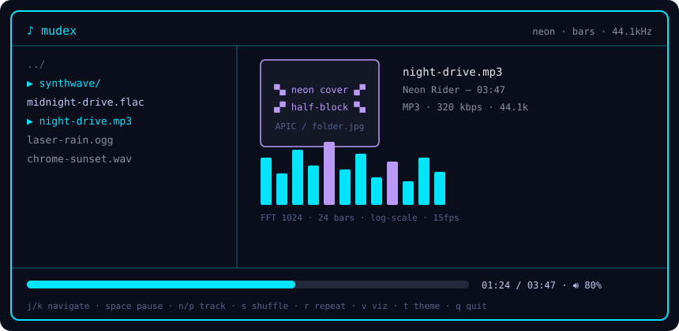

# 🎧 mudex — неоновый консольный плеер на Go + Bubble Tea


> Работает в любом Linux-терминале: обложка рисуется клетками (`▀` + ANSI),
> без Kitty Graphics / Sixel. Неоновый FFT-визуализатор, чистый Go. ⚡



## ✨ Фишки

| | |
|---|---|
| 🖼️ Обложки везде | Embedded APIC (mp3) → `cover.jpg`/`folder.jpg` → half-block рендер с Bayer-дизерингом → neon ASCII-заглушка |
| 📊 Живой FFT | Hann + FFT (1024) → 24 бара в log-scale, attack/release сглаживание, 15 fps |
| 🎨 6 тем | `neon` · `lamp` · `minimal` · `phosphor` · `paper` · `midnight` — переключение на лету (`t`/`T`) |
| 📺 6 режимов визуализатора | `auto` · `bars` · `vu` · `wave` · `dots` · `off` — клавиша `v` |
| 🚀 Мгновенный старт | Стриминг без декода целиком: старт ~15 мс, seek ~4 мс, RAM почти не растёт |
| 🔊 Без sudo | Звук через `miniaudio` (malgo) — собирается без `alsa-lib-devel` |

## 📦 Установка

```sh
git clone https://github.com/sudxxt-afk/mudex.git
cd mudex
go build -o mudex ./cmd/player
```

Требуется Go 1.24+ (см. `go.mod`). Опционально `ffmpeg`/`ffprobe`
для m4a/opus/aac/wma и точных длительностей при скане.

## 🎵 Форматы

- Нативно (без зависимостей): `mp3 / flac / wav / ogg`
- Через `ffmpeg` (если стоит): `m4a / opus / aac / wma` + всё остальное
- Звук: `miniaudio` (malgo) — собираются без `alsa-lib-devel`, `sudo` не нужен
- Стриминг: файлы не декодируются целиком — старт за ~15мс, seek за ~4мс, RAM почти не растёт
- Длительности при скане берёт `ffprobe` (если стоит)

## ▶️ Запуск

```sh
cd ~/Музыка
mudex                # браузер с текущей папки
mudex ~/Музыка       # браузер с указанной папки
```

Имя бинарника релиза — `mudex` (локальная сборка из `go build`
по умолчанию даёт `player`, оба имени эквивалентны).

## ⌨️ Управление

| Клавиши | Действие |
|---|---|
| `j/k`, `↑/↓` | Навигация |
| `Enter` | Войти в папку / играть |
| `Backspace`, `h`, `←` | Наверх |
| `Space` | Пауза / продолжить |
| `n` / `p` | Следующий / предыдущий трек в папке |
| `,` / `.` | Seek ∓5 с |
| `+` / `-` | Громкость |
| `s` | Shuffle |
| `r` | Repeat |
| `v` | Режим визуализатора |
| `t` / `T` | Тема |
| `Ctrl+P` | Настройки |
| `/` | Фильтр |
| `R` | Пересканировать папку |
| `q` | Выход |

## 🛠️ Как это устроено

```text
mudex
├── internal/library    — скан папки, фильтр расширений
├── internal/player     — декод в буфер 44100 stereo + tap для визуализатора, вывод через malgo f32
├── internal/cover      — embedded APIC (mp3) → cover.jpg/folder.jpg →
│                         half-block рендер с Bayer-дизерингом (truecolor/256) → neon ASCII-заглушка
├── internal/visualizer — Hann + FFT (1024) → 24 бара log-scale,
│                         attack/release сглаживание, 15 fps
├── internal/fonts      — шрифты для рендера
└── internal/ui         — Bubble Tea model: список слева, обложка+мета+визуализатор
                          справа, прогресс снизу; перерисовка обложки только при смене трека
```

---

<p align="center">Сделано на Go + Bubble Tea 💜 · Слушай в терминале 🎶</p>
